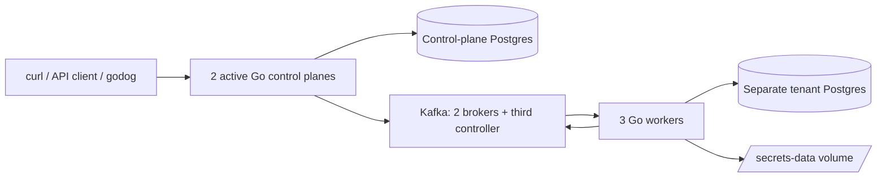

# Tenant Provisioning Control Plane

Go/OpenAPI control plane with **two active API replicas, three real
provisioning workers, PostgreSQL, replicated Kafka, and Gherkin end-to-end
tests**. No UI, no cloud account, no emulator: keys come from `.env`, tenant
infrastructure lives on a Docker volume, and everything else is Docker.

```sh
task up      # .env keys, image build, migration, topics, 2 control planes + 3 workers
task check   # boot + unit + integration + Gherkin + log assertion + scanners
```

The API is `http://127.0.0.1:8080` (replica 1). Replica 2 runs on the compose
network only; reach it with `docker compose exec control-plane-2 curl
--silent --fail http://localhost:8080/readyz`. Sign in with `ADMIN_EMAIL` and
`ADMIN_PASSWORD` from `.env`. Every authenticated user is an administrator.

Prerequisites: Docker with Compose v2 and [Task](https://taskfile.dev). Builds
and tests run inside pinned containers, so the host needs no Go toolchain or
C compiler. Allow roughly 4–6 GB for Docker.

## What it does

A tenant mutation is durable before it is acknowledged, and a worker then does
the real infrastructure work:



* **No leader.** Both replicas serve requests, relay tasks and consume
  results. Postgres transactions, row locks, optimistic versions and unique
  indexes decide concurrency; Kafka consumer groups divide work between
  workers.
* **Task rows are the outbox.** Each task holds an immutable command plus a
  `published` flag. The request hands the new task id to the relay goroutine;
  a one-second sweeper republishes anything still unpublished after five
  seconds. Both paths use the same `FOR UPDATE SKIP LOCKED` publish, so
  replicas cannot race. `CP_FAST_PUBLISH=false` disables only the in-request
  hand-off, which makes the sweeper deterministic.
* **At least once, idempotently.** A Postgres commit and a Kafka
  acknowledgement are never atomic. Stable command IDs (task id) and result
  IDs (UUIDv5 of `task_id|status`), inbox dedupe and durable worker receipts
  make duplication harmless.
* **Real provisioning.** Deploy creates a login role and database named
  `tenant_<slug-with-underscores>` on a Postgres server the control plane
  itself does not own. Update can import an existing database URL. Destroy
  drops only what the control plane created and never touches an imported
  database.
* **Infrastructure values never enter the control-plane database.** The
  `tenants` table stores `infra_secret_id`; the document
  `control-plane/tenants/<slug>/infra` (runtime env plus the managed
  database/role) is a JSON file under `/data/secrets` on a Docker volume.
* **Keys are environment configuration.** `M2M_SECRET` (32 bytes, base64)
  signs every broker message as HMAC-SHA256. `WORKER_SEAL_KEY` /
  `CONTROL_PLANE_RECEIVE_KEY` are a NaCl box keypair: the control plane seals
  an imported connection string to the worker's public key and only the worker
  can open it. Both are generated once by `task setup` and never rewritten,
  so signing stays valid across restarts — the exact class of failure an
  emulated KMS alias produced.
* **Read-consistent API.** Cursor pagination over tenants and tasks, task
  listings filtered by tenant, `Location` on every accepted mutation, and
  RFC 9457 problems on every error path, including router mistakes.
* **Meaningful logs only.** Structured JSON, one line per consequential event:
  startup, request failures with their problem code, task transitions,
  publishes/retries/dead-lettering, provisioning outcomes, shutdown. No
  heartbeat or poll chatter, and never a credential or connection string.
  `task logs:check` enforces both.

Implementation notes: pgx with explicit SQL and one embedded schema
(`internal/store/schema.sql`) rather than a generator plus migrations;
OpenAPI server code is generated and committed.

## API

Contract: [`api/openapi.yaml`](api/openapi.yaml). Messaging:
[docs/events.md](docs/events.md). Errors: [docs/problems.md](docs/problems.md).

Mutations return `202 {tenant, task}` with a `Location` header. Pagination uses
`limit` (1–100, default 20), `cursor` and optional `status`; task lists accept
`tenant_id` and `type` too. PATCH carries `version` in its body. Slugs are
immutable and stay reserved after destroy.

```sh
export $(grep -v '^#' .env | xargs)   # Linux/macOS; on Windows read .env manually

curl -c cookies.txt -H 'Content-Type: application/json' \
  -d "{\"email\":\"$ADMIN_EMAIL\",\"password\":\"$ADMIN_PASSWORD\"}" \
  http://127.0.0.1:8080/v1/auth/login

curl -b cookies.txt -H 'Content-Type: application/json' \
  -d '{"slug":"acme-prod","name":"Acme Production"}' \
  http://127.0.0.1:8080/v1/tenants

curl -b cookies.txt http://127.0.0.1:8080/v1/tenants/TENANT_ID
curl -b cookies.txt 'http://127.0.0.1:8080/v1/tasks?tenant_id=TENANT_ID'
curl -b cookies.txt -X PATCH -H 'Content-Type: application/json' \
  -d '{"version":2,"name":"Acme Renamed"}' http://127.0.0.1:8080/v1/tenants/TENANT_ID
curl -b cookies.txt -X DELETE http://127.0.0.1:8080/v1/tenants/TENANT_ID
curl -b cookies.txt http://127.0.0.1:8080/v1/workers
```

Sessions are `HttpOnly` cookies (12 h); `POST /v1/api-tokens` mints bearer
tokens (90 days). Set `COOKIE_SECURE=true` when you terminate TLS in front.

## Testing

```sh
task test:unit          # pure domain/crypto unit tests, race detector
task test:integration   # real Postgres outbox/inbox/concurrency semantics
task test:bdd           # Gherkin scenarios in features/ against the booted stack
task logs:check         # log volume and sanitization assertions
task check              # all of the above + formatting, vet, gitleaks, govulncheck
```

`features/tenants.feature` and `features/messaging.feature` are the executable
end-to-end specification: lifecycle, optimistic concurrency, error contract,
imported-database preservation, restart durability, outbox recovery, dead-
lettering, replay protection and idempotency. Steps run in `tests/bdd/` behind
the `bdd` build tag; `task bdd:stubs` regenerates Go stubs from the feature
files, and the implemented step code lives beside them. Scenario slugs get a
unique suffix per run, so scenarios never collide with earlier data, and
`task test:bdd` can be re-run at any time.

Concurrency scenarios use five clients, and "workers are stopped", "workers run
with fail rate 1" and "the control-plane services restart" are literal: the
suite drives the real containers through the mounted Docker socket, so the test
service mounts `/var/run/docker.sock` and reads container logs through the
Engine API rather than shelling out to the CLI.

To work on one scenario at a time without touching the feature files:

```sh
docker compose run --rm --no-deps -e BDD_SCENARIO= sweeper test go test -count=1 -tags bdd -v ./tests/bdd/...   # substring of a scenario name
docker compose run --rm --no-deps -e BDD_PATHS=features/messaging.feature test go test -count=1 -tags bdd ./tests/bdd/...
```

Both variables only narrow what runs; `task test:bdd` always runs everything.
`tests/bdd/steps_generated.go` is the registration table godog produced from
the feature files - edit the features, then `task bdd:stubs`, and implement the
handlers it reports as pending.

Layout of the suite: `steps_generated.go` is generated and committed;
`steps_tenants.go`, `steps_contract.go` and `steps_messaging.go` are the
implementations behind the three kinds of step in the features (lifecycle and
provisioning, the HTTP contract, broker messaging); `fixtures.go` holds the
shared "give me a tenant in this state" helpers; and `client.go`, `bus.go`,
`resources.go`, `containers.go`, `progress.go` and `state.go` are the harness -
HTTP client, broker access, tenant-server and secret-store reads, container
control, consumer-progress measurement and per-scenario state. A step never
reaches into a database it could call an API for, and the harness never
re-implements a protocol the services speak.

## Reproducing scenarios by hand

```sh
task scenario:fail              # workers with fail rate 1; new tasks fail
task scenario:reset             # restore success before destroying
task scenario:slow              # 20-30 s work delay; watch accepted -> in_progress
task scenario:poison            # undecodable message -> tenant.task-updates.v1.dlq
task scenario:unsigned TASK=... TENANT=...    # valid shape, no signature -> DLQ
task scenario:duplicate TASK=... TENANT=...   # same terminal update twice
task scenario:out-of-order TASK=... TENANT=...  # done before in_progress
task scenario:fast-publish-off  # sweeper-only publishing (15 s to appear)
task scenario:fast-publish-on
task broker:publish -- --task TASK_ID --tenant TENANT_ID --status in_progress
task broker:tail TOPIC=tenant.task-updates.v1.dlq
task db:psql                    # control-plane database
task tenant:psql                # tenant resource server
```

Worker flags `--worker-id`, `--fail-rate`, `--min-delay-ms`, `--max-delay-ms`
override their environment. Six task partitions bound the useful worker count.

## Logs

One structured JSON line per consequential event, and nothing else. A full
lifecycle, from the request through the worker to the terminal result:

```json
{"level":"INFO","msg":"control-plane listening","address":":8080","fast_publish":true}
{"level":"INFO","msg":"tenant created","tenant_id":"5f10f6f0-...","slug":"acme-prod-43d1e8","status":"provisioning","task_id":"47c9609f-...","task_type":"deploy"}
{"level":"INFO","msg":"task transition","task_id":"47c9609f-...","task_type":"deploy","status":"in_progress"}
{"level":"INFO","msg":"provisioning finished","worker":"worker-1","task_type":"deploy","status":"done","code":""}
{"level":"INFO","msg":"task transition","task_id":"47c9609f-...","task_type":"deploy","status":"done","tenant_id":"5f10f6f0-...","tenant_status":"active","version":2,"code":""}
```

`task logs:check` enforces the standard after a full suite run: every line must
be a JSON record with `time`, `level` and `msg`; no line may contain a
configured secret, a connection string or a sealed value; and an idle stack
must produce essentially nothing (it measures a quiet window, so per-heartbeat
or per-poll logging fails the gate). `CP_LOG_LEVEL=debug` adds the dedupe and
retry detail without changing the info-level story.

Worker presence is operational state, not history: `GET /v1/workers` reports
workers that beat within the last 15 seconds, and a row for a worker that has
not beaten in an hour is pruned on read. Container names are pinned in
compose, and a container recreated to change its environment keeps its
hostname, so a worker's identity survives the change instead of becoming a new
row.

## Consistency and availability trade-offs


* Kafka has a leader **per partition**, not a cluster master. RF=2 with
  min ISR=2 means both brokers must acknowledge; losing one pauses new
  publications while task acceptance continues (Postgres is enough for that).
  A third controller-only process keeps controller quorum with one broker down
  but adds no data replica.
* Both Postgres servers are single-node local dependencies; two API replicas do
  not make the database highly available.
* One shared HMAC key is the requested machine-to-machine model. Any worker can
  sign, so signing ability equals trust; per-worker identities are future work.
* Signatures do not expire, which is what a durable queue needs — but it also
  means a leaked key is a serious event. Rotating `M2M_SECRET` invalidates
  every queued message; draining the topics first is the safe order.
* Imported URLs are write-only inputs limited to 8 KiB; NaCl sealed boxes carry
  no size limit for a connection string, and the task command stores ciphertext
  only.
* Document names/roles are quoted identifiers. Provisioning writes intent (with
  the generated password) to the secret **before** `CREATE ROLE`, so a retry
  reuses the same credential instead of fabricating a second one. The receipts
  table on the tenant server records completed task ids, so replaying an old
  deploy cannot resurrect destroyed infrastructure.

## Deploying with real cloud services

Nothing here requires AWS. For production you would replace two things and
leave the protocol alone:

* **Key custody.** `M2M_SECRET` and the seal keypair can come from a KMS/HSM or
  a secret manager instead of `.env`. Keep the envelope format: HMAC over
  `header.claims` with the digest of the full body, so the version tag and
  digest checks survive. Plan for overlap, not instant cut-over: a new key must
  verify old messages while a deployment drains, and sealed blobs must never be
  replayed across a rotation.
* **Secret storage.** `internal/secretstore` is one interface
  (`Get`/`Put`/`Delete`) with an atomic-rename file backend; a managed secret
  service implementation is a drop-in. Keep the document shape and the
  `control-plane/tenants/<slug>/infra` id so task commands stay valid.
* Tenant administrator credentials (`TENANT_DB_ADMIN_URL`) and the broker
  credentials belong in the deployment environment, not in the control-plane
  database — that boundary is deliberate.

Run the control planes behind a TLS terminator, set `COOKIE_SECURE=true`,
enable Kafka TLS/SASL, and put rate limiting in that front proxy (the
application answers 429 nowhere).
